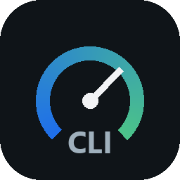

# Speedtest CLI Android · Download

Mede latência, jitter, download e upload **no próprio aparelho** e compara **dois servidores lado a lado** (Android 11+).

**[Página de download](https://fbrendler.github.io/speedtest-cli-android-download/)** ·
**[Baixar a versão mais recente (APK)](https://github.com/fbrendler/speedtest-cli-android-download/releases/latest/download/speedtest-cli-android.apk)**

## O que faz

- Latência, jitter, download e upload sem abrir outro app.
- Comparação A × B na mesma conexão, com ✓ no melhor de cada linha e variação em %.
- 32 servidores Claro no Brasil (três em Florianópolis: 16338, 21732 e 1201).
- "Usar minha localização" escolhe o servidor mais próximo e sugere outro da mesma cidade.
- Resultado copiável em JSON com as duas medições.

Este repositório contém só os arquivos publicados (APK nas [Releases](https://github.com/fbrendler/speedtest-cli-android-download/releases) e a página de download). O código-fonte é privado.

by BRENDLER™
